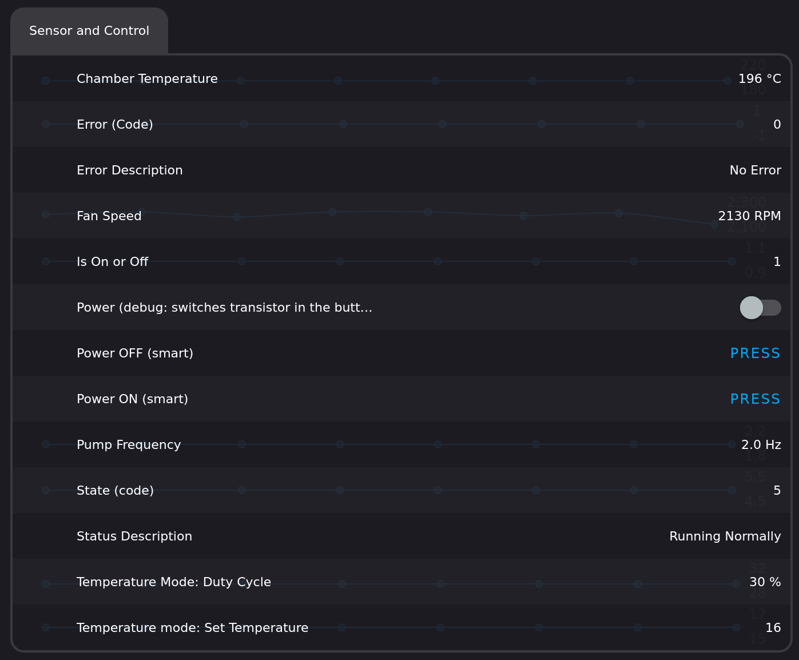
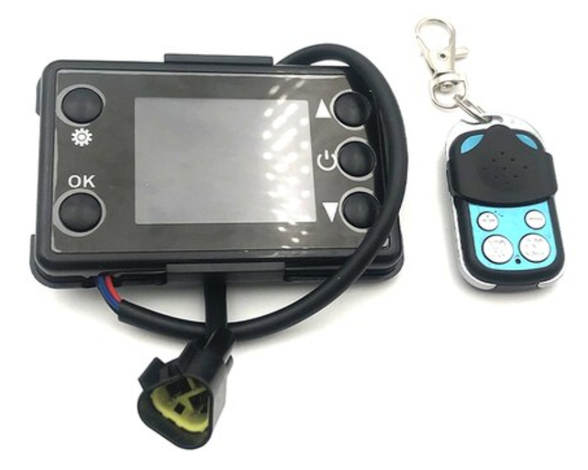
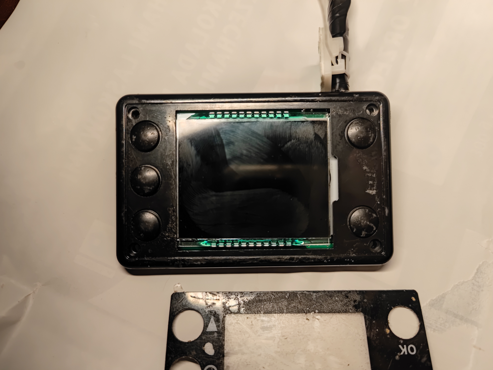
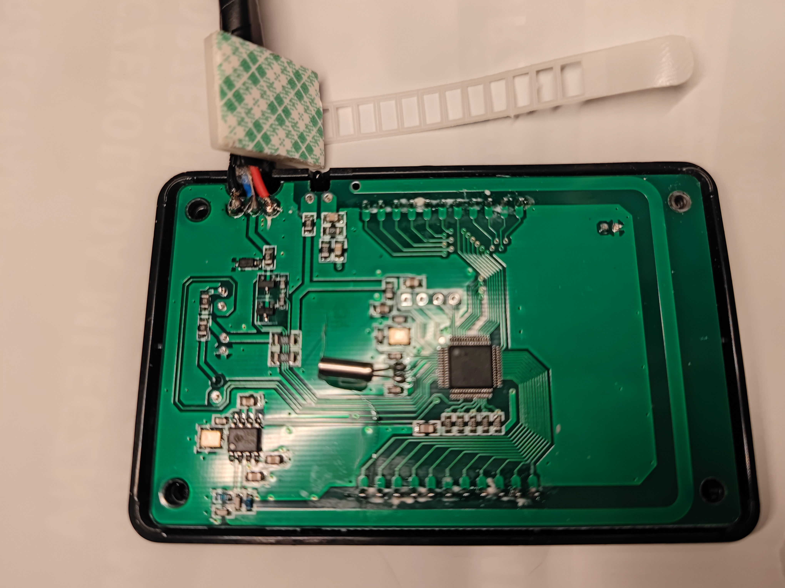
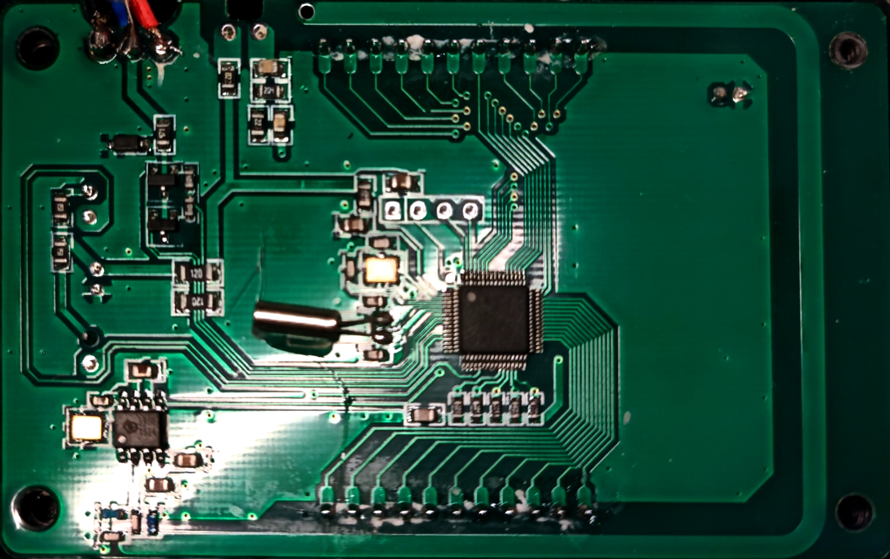
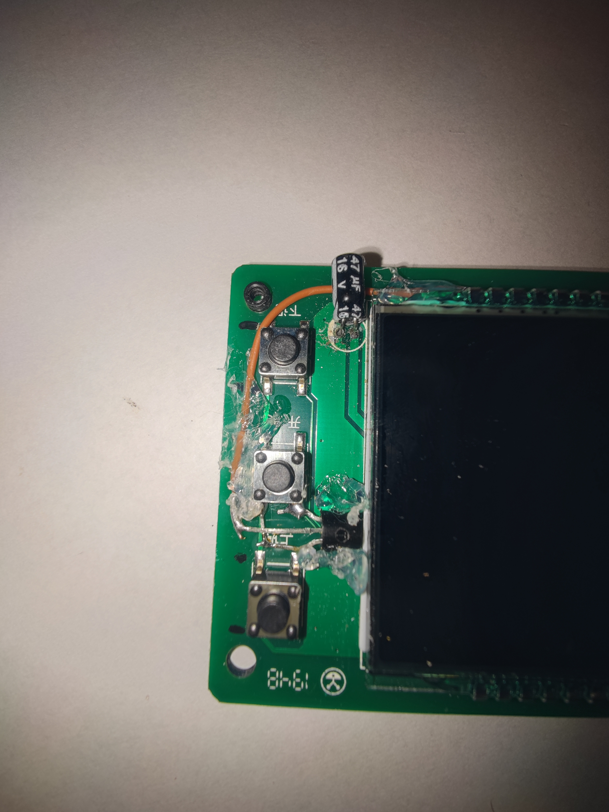
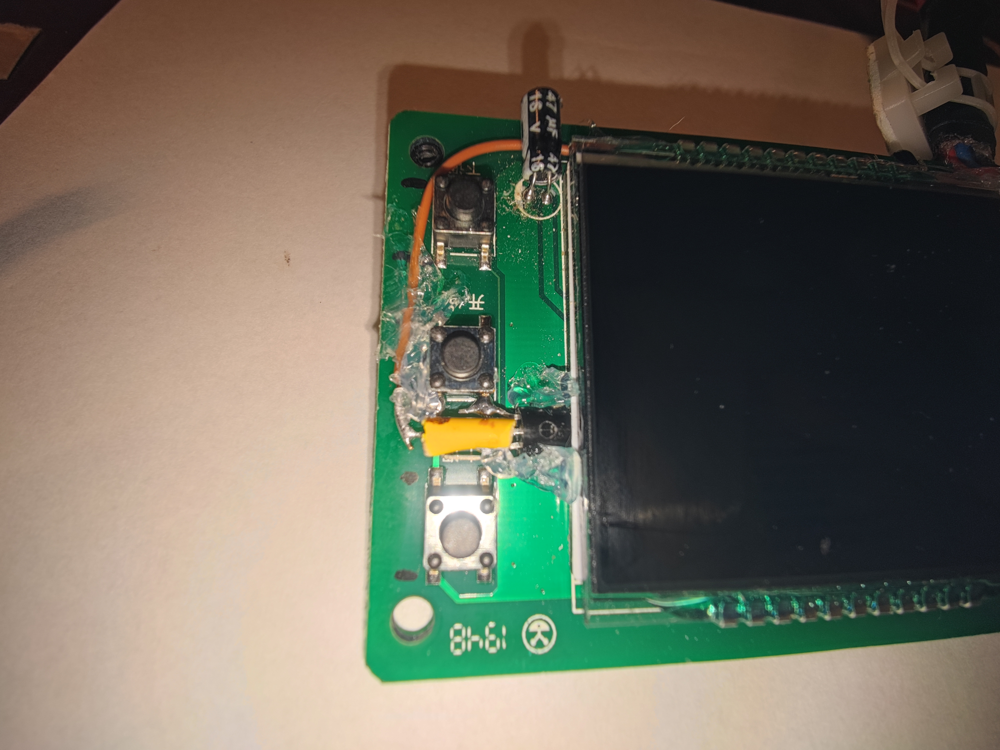
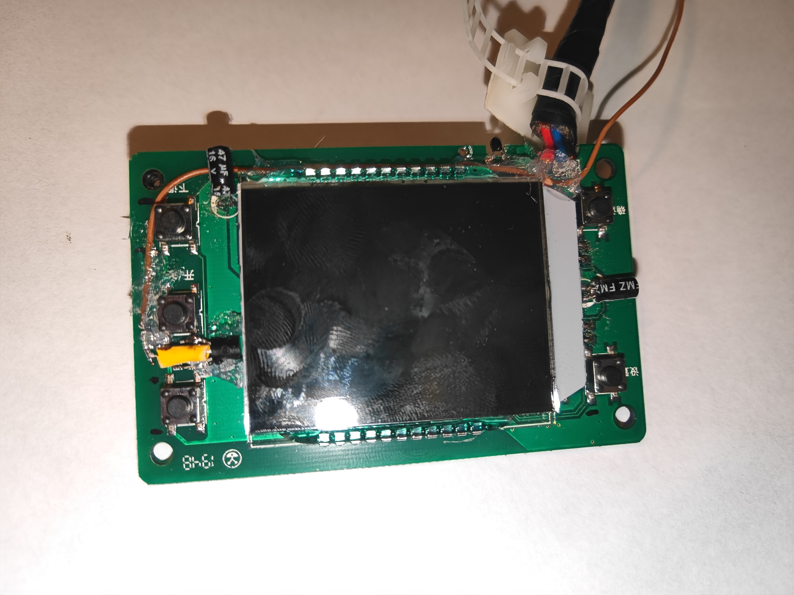
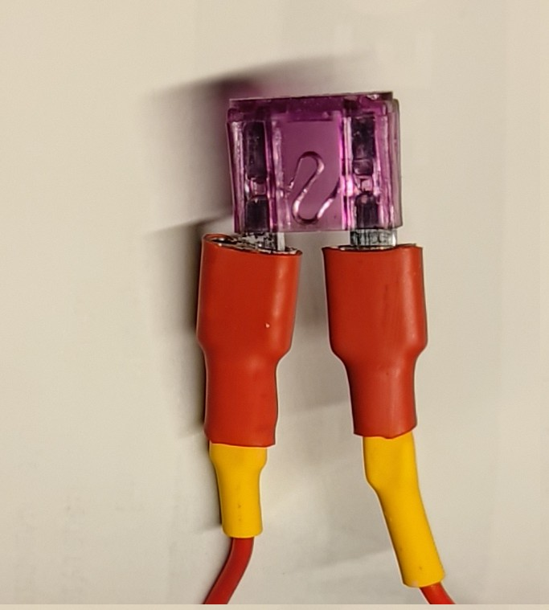

# **ESPHome-Chinbasto**

A custom ESPHome component for controlling Chinese Webasto heaters using ESP32. It reads the heater's serial bus, and it can now start the heater **over that bus, with no soldering** (experimental, proven on the author's heater). The soldered button transistor stays as the standard control path. It is based on the work of [timmchugh11](https://github.com/timmchugh11/Chinese-Diesel-Heater---ESPHome) and builds on the reverse engineering efforts of **Ray Jones**.

[](LICENSE)

---

## **Table of Contents**
1. [Introduction](#introduction)
2. [Features](#features) 
3. [Roadmap - nice to have in future](#roadmap---nice-to-have-in-future)
4. [Hardware Requirements](#hardware-requirements)
5. [Software Installation on ESP32](#software-installation-on-esp32)
6. [Configuration](#configuration)
7. [Usage](#usage)
8. [Hardware modification - On/Off Switch control](#hardware-modification---onoff-switch-control)
9. [Documentation](#documentation)
10. [Credits](#credits)
11. [License](#license)

---

## **What's new (2026-11)**

Flashed and proven on the author's heater on 2026-11-12.

- **Serial ON over the blue wire works.** No soldering. One MQTT message
  started a cold heater: `Starting` after 1 s, `Pre-Heat` after 2 s, then
  a full ignition. The bus stayed clean: zero bad frames around the
  ESP's own transmission. Serial OFF is built, not yet tested.
- **About 7 times less MQTT traffic.** The component decides when each
  value goes out (`publish_policy.h`). A state or error change still
  goes out at once. Measurements go out once a minute, as a window:
  the mean fan speed, the last pump and chamber values, and the
  minute's chamber peak, so no peak is lost between sends. Unchanged
  values go out every 5 min as a refresh. Steady running: 28 messages
  in 5 min, about 5.6 a minute. The old firmware sent about 40 a
  minute, an unfiltered rewrite about 120.
- **Less power.** CPU at 80 MHz instead of 240 MHz. WiFi transmit
  power 8.5 dB. Fewer messages means fewer WiFi transmit bursts, and the
  radio pays per wake-up. Bluetooth off. The ESP ran a whole heater
  start on the panel's 5 V line, through a supply dip to 10.4 V,
  without a reset.
- **Debug data on demand.** One switch turns on a JSON message with
  the frame counters by reject reason, the raw protocol fields (supply
  voltage, glow plug voltage and current, the panel's pump and fan
  limits) and the last exchange as hex. Off after every boot.
- **A real external component.** `components/diesel_heater/`, built on
  ESPHome 2026.10.2 and ESP-IDF 5.5.6. No `custom_component`, no pin
  to ESPHome 2024.12.
- **Robust receive path.** CRC check, range checks, bounded loops, no
  blocking `delay()`. A link watchdog: `link` reads 0 after 10 s with
  no valid exchange. The bus carries about 3.3 exchanges per second.
- **Tested off the device.** 46 protocol tests through ESPHome, and
  189 glue checks of the whole component against an ESPHome fake, under
  AddressSanitizer and UndefinedBehaviorSanitizer. About 40 hand
  mutations, each one caught.

---

## **Introduction**
This project enables control of Chinese Webasto heaters using ESP32 and ESPHome. It extends the functionality of the original work by [timmchugh11](https://github.com/timmchugh11/Chinese-Diesel-Heater---ESPHome) and incorporates insights from **Ray Jones**' reverse engineering of the serial communication protocol.

The component reads the serial bus and publishes the heater's values. On/off control works two ways: the soldered button transistor on a GPIO pin (standard), or a command frame over the serial bus (experimental, no soldering).

---

## **Features**
- **Serial monitoring**: heater status, chamber temperature, fan speed, pump frequency, errors, link state.
- **Serial ON/OFF (experimental)**: start the heater over the blue wire, no soldering. Serial ON proven, serial OFF not yet tested.
- **On/Off control by button**: the soldered transistor, see below.
- **Low traffic, low power**: change-driven MQTT, one-minute measurement windows, CPU 80 MHz.
- **Smart On/Off**: Automatically handles 1-second or 3-second button presses based on the heater's current state.
- **MQTT integration**: Publish heater data to an MQTT broker.
- **OTA updates**: Update the firmware over-the-air (ESPHome feature)
- **Web interface**: Access a local web interface for monitoring and control (ESPHome feature):



## **Roadmap - nice to have in future**
- Test serial OFF, then repeat serial ON and OFF until they can replace the soldered button.
- Optional: with the heater off, send measurements every 5 min instead of every minute.

Done: control without soldering (serial ON, experimental), and the
refactor to a proper ESPHome component.
---

## **Hardware Requirements**
- **ESP32 development board** (e.g., ESP32 DevKit).
- **Chinese Webasto heater** with a compatible control board: "3-wire": the 3 wires: red,blue and black connect to webasto controller via "triangle" connector
- **Soldering tools**: To connect GPIO pins for on/off control.
- **1k resistors**: For connecting GPIO pins to the heater's control board.
- **Wiring**: Connect the ESP32 to the heater's serial interface and GPIO pins.

### **Compatibility**
This project is compatible and proven to work with "six blade universal controller" types - using designation from Van Life UK blog author.

Check excellent writeup of controllers and ECUs at [Van Life UK: Chinese Diesel Controller, Motherboard & Remote Control Guide](https://www.vanlifeuksurvivorsguide.co.uk/post/chinese-diesel-heater-controller-motherboard-remote-control-guide) |
[Web Archive Snapshot from 14th Sep 2024](https://web.archive.org/web/20240915140812/https://www.vanlifeuksurvivorsguide.co.uk/post/chinese-diesel-heater-controller-motherboard-remote-control-guide)

Note: I have bought heater with black controller. I had replaced it with blue controller which has a much better remote with tiny OLED display. 

For the mod I have played with soldering the black one. Success!




---

## **Software Installation on ESP32**
1. **Clone the repository**:
   ```bash
   git clone https://github.com/pavelw/esphome-chinbasto.git
   cd esphome-chinbasto
   ```

2. **Install ESPHome**:

   The component is an external component and builds on current
   ESPHome (tested with 2026.10.2). The old `esp32-webasto36.yaml`
   still needs ESPHome 2024.12.0, because it uses the removed
   `custom_component`. Use `esp32-webasto36-component.yaml` instead.

   The first flash from an old Arduino build must go over USB: the
   ESP-IDF build uses another partition table, and OTA cannot change
   it. Later updates go over OTA.

3. **Set up `secrets.yaml`**:
   - Copy `secrets.yaml.template` to `secrets.yaml` and fill in your Wi-Fi credentials, MQTT broker details, and OTA password.

4. **Compile and upload**:
   - Compile the firmware and upload it to your ESP32:
     ```bash
     esphome run esp32-webasto36-component.yaml
     ```

---


## **Hardware modification - On/Off Switch control**
To add **on/off control** to your heater, you need to solder transistor to the board. This is temporary albeit fully working solution until someone manages to control via UART, see [Roadmap - nice to have in future](#roadmap---nice-to-have-in-future).

Parts required, besides ESP32:
- 1 transistor, type 2N2222
- 1 resistor, 1K Ohm

### **Transistor Pin Identification**
When soldering to the control board, you will need to identify the **emitter, base, and collector** of a transistor. 
If you dont have this info from spec sheet, then:
1. Set multimeter to diode mode, black probe in COM port, red probe in voltage port.
2. Assume that we have NPN type transistor (2N2222 is that type) and BASE is in the middle.
3. Keep red probe on middle leg and read values when black probe is connected to each of other legs of the transistor

Result: 
- Higher voltage drop (~0.7V readout on multimeter) → Emitter.
- Lower (~0.5V readout on multimeter) → Collector.
 
 A helpful video tutorial on which I based above method can be found here:  
[How to Identify Emitter, Base, and Collector on a Transistor](https://www.youtube.com/watch?v=W5yfAZoE5sY)


### Power control modification

1. Front cover disassembly  


2. Backplate overview 
 
- Blue wire: serial connection wire
- Red wire: 5V DC for the panel. Do not power the ESP32 from it. Read step 8.
- Black wire: Ground. connect this to GND of ESP32 (REQUIRED otherwise reading serial connection will not work)


3. Close-up of backplate  


4. Transistor - before insulation


short version:

```
ESP32 GPIO 13 → 1kΩ Resistor → Transistor Base  
Transistor Emitter → Button Ground Terminal  
Transistor Collector → Button Signal Terminal
```
long descrpition:

- check using multimeter which pins of button are going to the ground. Use "contuinity check" with one probe connected to negative wire (see pic 2).
For my controller, the negative ones were ones on left side, both on top on bottom of the power button.
- keep transistor fixed, I have used hot glue
- transistors' EMITTER pin connect to GROUND of the switch. On the picture its the bottom one, I have made its long feet turn almost 90 degrees up to the button solder point.
- transistor's COLLECTOR pin connect to other side of the switch. On the picture it is the top most one.
- transistor's BASE pin (middle one) goes through 1K resistor, then to ESP32 pin (brown cable on the picture). Make sure it does not touch the other pins - insulate it after soldering!

5. Transistor after insulation of the BASE pin

Make sure that it is possible to close the case of controller.
I have routed the wire to top, exiting together with three wires standard.

6. Solder wire into negative output of controller (black line).
Connect it to GND of the ESP32.
This is required to have serial reading working.

7. Completed installation  



8. Power the ESP32 from its own supply. Do not use the red +5V line.

The red line is the 5V the heater's main board makes for the panel.
The panel needs little current. A typical ESP32 board draws 80 to
150 mA on average, and 300 to 500 mA in WiFi transmit peaks. That is
likely more than the line can supply. Not measured.

The author powered the ESP32 from the red line, through a 3A blade
fuse, for over a year. Then it failed: the ESP32's red LED blinked
fast, the panel display blinked at the same moments, and the ESP32
never came online. It happened with the heater fully off too. Before
that, the ESP32 hung twice after a heater power event (a battery cut,
an overheat trip).

Use this instead:
- A 12V to 5V step-down converter, 1A or more, fed from the 12V
  battery through its own fuse. Output to the ESP32's VIN and GND.
- Keep the black ground wire from step 6 on the ESP32's GND. The
  serial reading needs the common ground.
- Check that the converter's negative and the heater's negative go to
  the same battery negative.

The old wiring, for reference. Do not copy it:



## **Configuration**
### **YAML Configuration**
The main configuration file is `esp32-webasto36.yaml`. Key sections include:
- **Wi-Fi**: Configure your Wi-Fi network.
- **MQTT**: Set up MQTT integration for remote monitoring.
- **UART**: Configure serial communication with the heater.
- **GPIO**: Define pins for on/off control.

### **The diesel_heater component**
`components/diesel_heater/` reads the blue-wire bus and publishes the
heater's values. It started from the work of
[timmchugh11](https://github.com/timmchugh11/Chinese-Diesel-Heater---ESPHome),
based on the protocol documented by **Ray Jones**, and was rewritten
here. `esp32-webasto36-component.yaml` is the full example.

Keys, all sensors except the text ones:

| Key | Required | Sent |
|---|---|---|
| `state`, `on_off`, `error` | yes | on change, and every 5 min |
| `active_error`, `set_temperature` (demand), `link` | no | on change, and every 5 min |
| `pump_frequency` | yes | once a minute, the last value |
| `fan_speed` | yes | once a minute, the mean |
| `chamber_temperature` | yes | once a minute, the last value |
| `chamber_temperature_max` | no | once a minute, the highest value of that minute |
| `state_text`, `error_text` | no | with their number |
| `debug_data` | no | one JSON text per update, only while debug is on |

Every MQTT message is a WiFi transmit burst, so unchanged values go out
only as a refresh. A state or error change goes out at once. After a
link loss everything goes out again. `link` reads 0 when no valid
exchange arrived for 10 s; the other values then stop.

Debug data holds the frame counters by reject reason, the duty value,
the raw protocol fields and the last 48-byte exchange as hex. Turn it on
with a template switch that calls `id(heater).set_debug(true)`. It is off
after every boot.

Serial ON and OFF over the blue wire are experimental: call
`id(heater).request_on()` or `request_off()`. They need TX on the same
pin, open-drain. The example wires them to two buttons. The component
copies the controller's last frame, sets the command byte, writes the
CRC, and sends it from `loop()` 50 ms after a fresh valid exchange,
never by blocking. It drops its own echo from the receive path.

Serial ON, proven 2026-11-12 on the author's heater (blue controller):
`Starting` after 1 s, `Pre-Heat` after 2 s, ignition after 2 min 39 s,
`Running Normally` after 5 min 11 s, zero bad frames in 4223 exchanges. Serial OFF: not yet tested.

Tests: `tests/host/` (protocol, through ESPHome) and `tests/glue/`
(the whole component against an ESPHome fake, with sanitizers). Read
their `README.md`.

---

## **Usage**
1. **Monitor heater status**:
   - Use the ESPHome web interface or MQTT to monitor the heater's status, temperature, fan speed, and error codes.

2. **Control the heater**:
   - Use the web interface or MQTT commands to turn the heater on/off.
   - The **Smart On/Off** feature automatically handles 1-second or 3-second button presses based on the heater's current state.

3. **Debugging**:
   - Turn on the "Debug data" switch for the counters, raw fields and hex.
   - Set `dump_packets: true` and the logger to DEBUG for every exchange.

---

## **Documentation**

### **Smart On/Off Control**
The **Smart On/Off** feature in the YAML configuration automatically handles the required button press duration:
- **1-second press**: Turns the heater on.
- **3-second press**: Turns the heater off.

This is exposed in ESPHome Web Panel and as MQTT command.


### **Serial Protocol**
The serial communication protocol for Chinese Webasto heaters was reverse-engineered by **Ray Jones**. Detailed documentation can be found in his work:
- [V9 - Hacking the Chinese Diesel Heater Communications Protocol](https://gitlab.com/mrjones.id.au/bluetoothheater/-/blob/master/Documentation/V9%20-%20Hacking%20the%20Chinese%20Diesel%20Heater%20Communications%20Protocol.pdf?ref_type=heads)

### **ESPHome Configuration**
- Refer to the [ESPHome documentation](https://esphome.io/) for details on configuring ESPHome components.

---

## **Credits**
This project builds on the work of:
- **[timmchugh11](https://github.com/timmchugh11/Chinese-Diesel-Heater---ESPHome)**: Original ESPHome integration for Chinese diesel heaters.
- **[Ray Jones](https://gitlab.com/mrjones.id.au/bluetoothheater/-/blob/master/Documentation/V9%20-%20Hacking%20the%20Chinese%20Diesel%20Heater%20Communications%20Protocol.pdf?ref_type=heads)**: Reverse engineering of the serial communication protocol.
[Ray Jones - Hacking the Chinese Diesel Heater Communications Protocol V9.pdf](resources/Ray%20Jones%20-%20Hacking%20the%20Chinese%20Diesel%20Heater%20Communications%20Protocol%20V9.pdf) - from
[gitlab.com/mrjones.id.au/bluetoothheater](https://gitlab.com/mrjones.id.au/bluetoothheater/-/blob/master/Documentation/Hacking%20the%20Chinese%20Diesel%20Heater%20Communications%20Protocol%20V9.docx?ref_type=heads)

---

## **License**
This project is licensed under the **MIT License**. See the [LICENSE](LICENSE) file for details.
