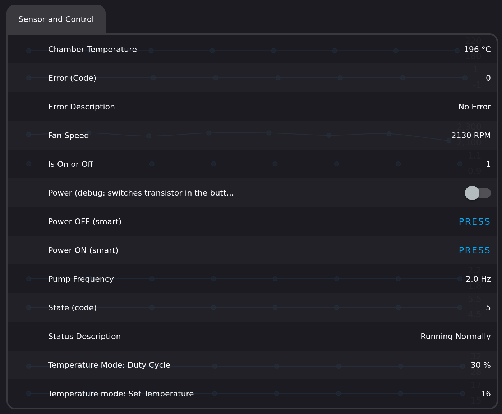
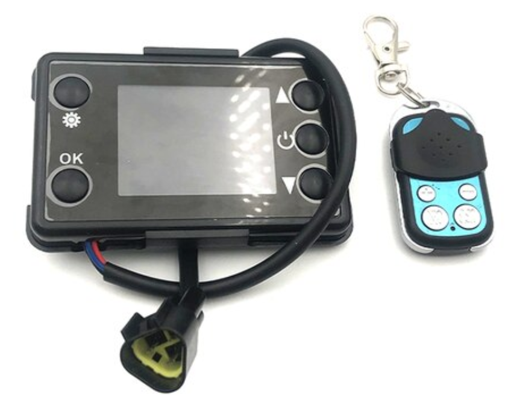
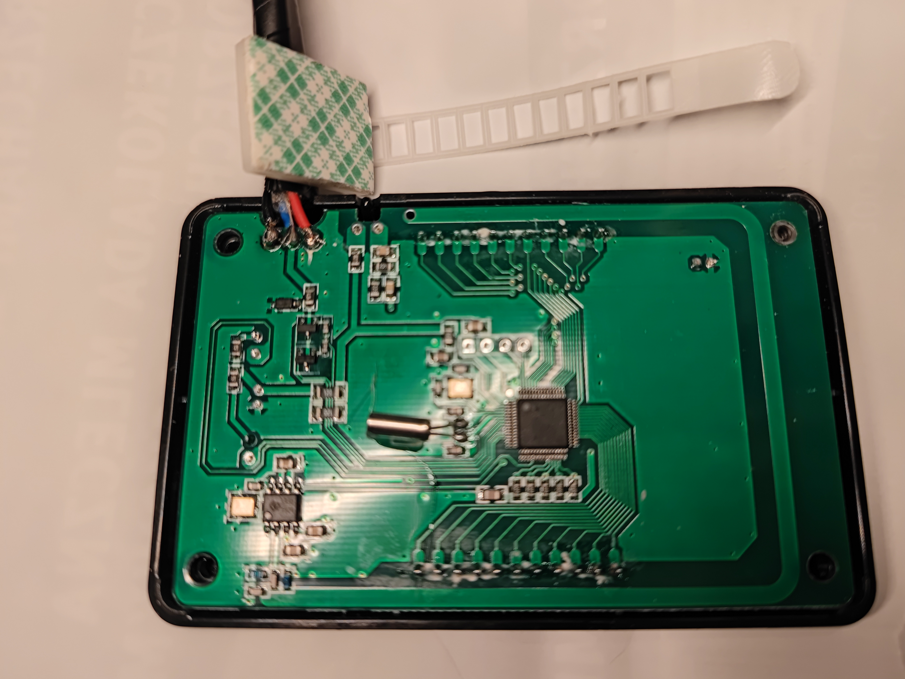
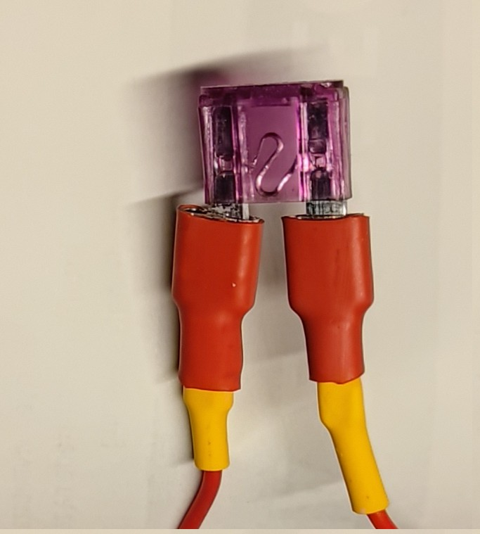
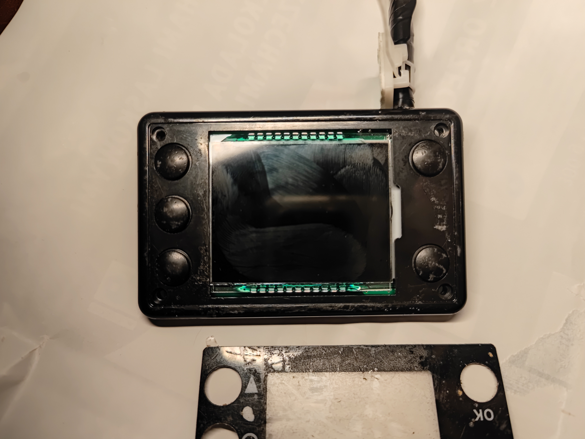
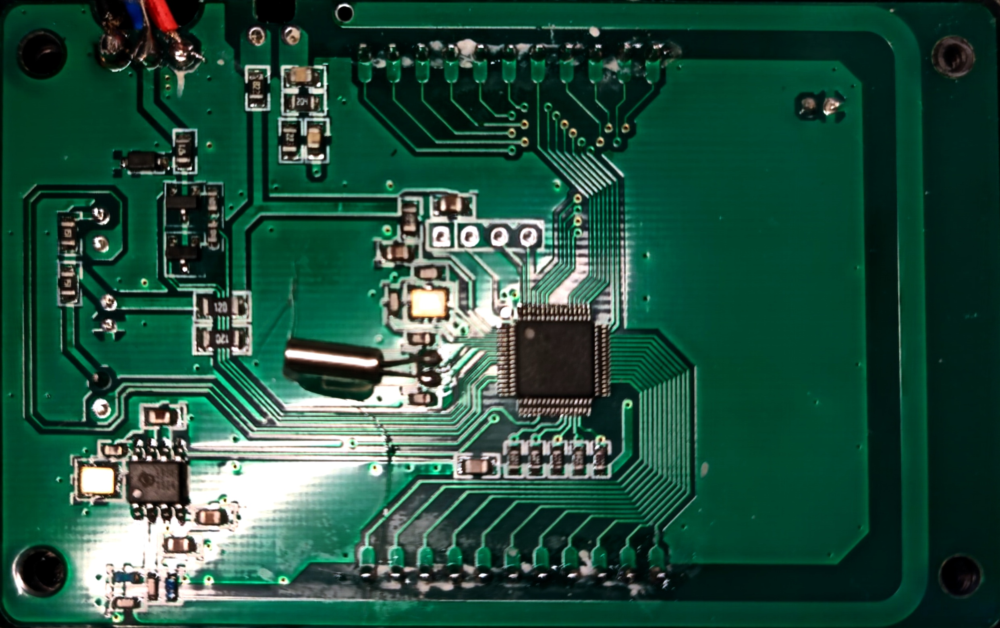
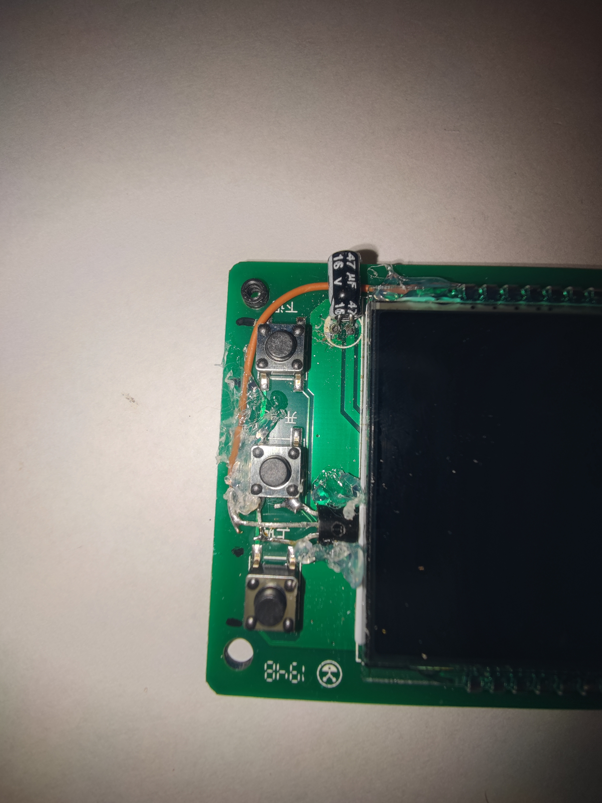
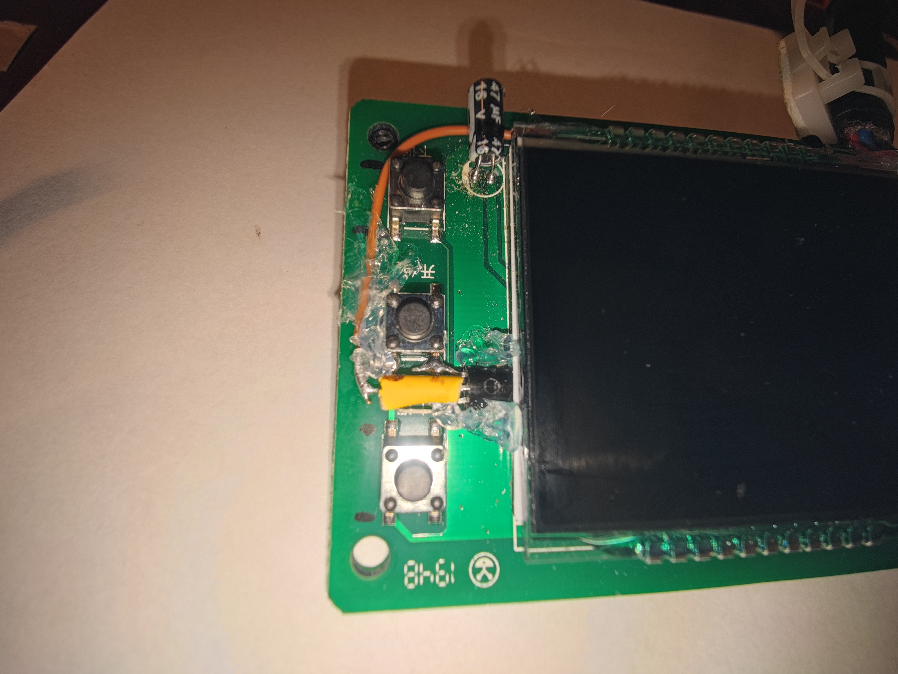
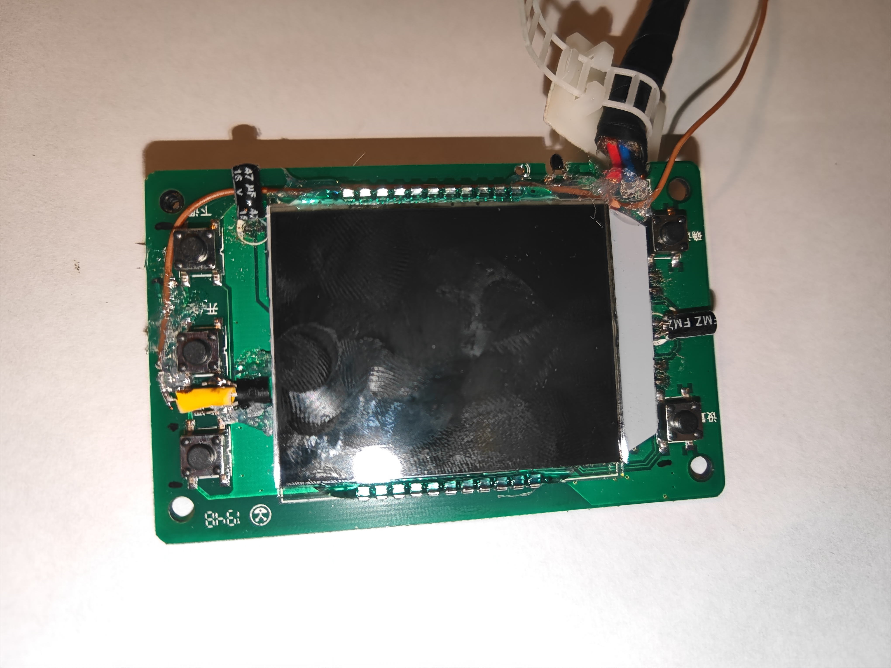

# ESPHome-Chinbasto

ESPHome external component for Chinese diesel air heaters with the
3-wire "blue wire" panel. An ESP32 reads the panel-to-heater bus and
publishes the heater state over MQTT. It starts the heater over the bus,
with no soldering (experimental). A soldered button transistor is the
standard control path.

Fork of [timmchugh11/Chinese-Diesel-Heater---ESPHome](https://github.com/timmchugh11/Chinese-Diesel-Heater---ESPHome).
Protocol by **Ray Jones**. The upstream README is
[README-upstream.md](README-upstream.md).


---

## Contents

1. [What's new](#whats-new)
2. [Features](#features)
3. [Status](#status)
4. [Hardware](#hardware)
   1. [Compatible heaters](#compatible-heaters)
   2. [Parts](#parts)
   3. [The three panel wires](#the-three-panel-wires)
   4. [Power supply](#power-supply)
5. [Button transistor (optional)](#button-transistor-optional)
6. [Install](#install)
7. [Configuration](#configuration)
   1. [Component keys](#component-keys)
   2. [Publish policy](#publish-policy)
   3. [Debug data](#debug-data)
   4. [Serial ON and OFF](#serial-on-and-off)
8. [Usage](#usage)
9. [Tests](#tests)
10. [Roadmap](#roadmap)
11. [Protocol](#protocol)
12. [Credits](#credits)
13. [License](#license)

Open work: [TODO.md](TODO.md).

---

## What's new

Flashed and proven on the author's heater, 2026-11-12.

- **Serial ON works. No soldering.** One MQTT message started a cold
  heater. `Starting` after 1 s. `Running Normally` after 5 min 11 s.
  Zero bad frames in 4223 exchanges.
- **Serial OFF works too.** `Stopping` after 1 s, `Off` after 9 min 39 s
  of post-run glow and cool-down. Zero bad frames in 16142 exchanges.
- **About 7 times less MQTT traffic.** About 5.6 messages a minute while
  running. The old firmware sent about 40. State changes still go out at
  once.
- **Lower power.** CPU 80 MHz. WiFi transmit power 8.5 dB. Bluetooth
  off. Fewer WiFi transmit bursts.
- **Debug data on demand.** One switch. Frame counters, raw fields, the
  last exchange as hex.
- **A real external component.** Builds on ESPHome 2026.10.2, ESP-IDF
  5.5.6. No `custom_component`.
- **Tested off the device.** 46 protocol tests. 189 glue checks under
  AddressSanitizer and UndefinedBehaviorSanitizer.

---

## Features

| Feature | Detail |
|---|---|
| Monitoring | Run state, chamber temperature, fan speed, pump frequency, demand, last error, live error, link state |
| Chamber peak | Highest chamber temperature of each minute. No peak lost between sends |
| Serial ON and OFF | Over the blue wire. Experimental. Both proven once |
| Button control | Soldered transistor across the panel's power button. Smart on/off: 1 s press on, 3 s press off |
| Low traffic | Change-driven MQTT. One-minute measurement windows. 5 min refresh |
| Link watchdog | `link` reads 0 after 10 s with no valid exchange |
| Robust receive | CRC check, range checks, bounded loops, no blocking `delay()` |
| Debug data | JSON on demand: reject counters, raw protocol fields, exchange hex |
| ESPHome extras | OTA updates. Local web interface |



---

## Status

| Item | State |
|---|---|
| Monitoring | Proven, 2026-11-12 |
| Publish policy | Proven, 2026-11-12 |
| Serial ON | Proven once, 2026-11-12 |
| Serial OFF | Proven once, 2026-11-13 |
| Button transistor | In use since 2024 |
| OTA | Works. The first OTA after a USB flash rolled back once. Retry once if it happens |

Serial becomes the primary control path after about 10 ON and OFF
cycles. The button then stays as the fallback. Reason: serial copies the
panel's frame, so it needs the panel on the bus. The button does not.

---

## Hardware

### Compatible heaters

Proven on the "six blade universal controller" type. Name from the
[Van Life UK controller guide](https://www.vanlifeuksurvivorsguide.co.uk/post/chinese-diesel-heater-controller-motherboard-remote-control-guide)
([archive, 2024-09-14](https://web.archive.org/web/20240915140812/https://www.vanlifeuksurvivorsguide.co.uk/post/chinese-diesel-heater-controller-motherboard-remote-control-guide)).

The panel connects to the heater through a triangle connector with three
wires: red, blue, black.

The author replaced the original black panel with the blue panel. The
blue panel has a better remote with a small OLED display. The solder
mod below was done on the black panel.




### Parts

- ESP32 development board, for example ESP32 DevKit.
- 12 V to 5 V step-down converter, 1 A or more, with its own fuse.
- Wires to the panel's blue and black lines.
- Optional, for the button: one 2N2222 transistor, one 1 kΩ resistor,
  soldering tools.

### The three panel wires



| Wire | Function | Connect to |
|---|---|---|
| Blue | Serial bus, 25000 baud | ESP32 GPIO21. RX and TX share it. TX open-drain |
| Black | Ground | ESP32 GND. Required: the serial reading needs the common ground |
| Red | 5 V for the panel | Nothing. Read [Power supply](#power-supply) |

### Power supply

Power the ESP32 from its own supply. Do not use the red 5 V line.

The red line is the 5 V the heater's main board makes for the panel.
The panel needs little current. An ESP32 board draws 80 to 150 mA on
average, 300 to 500 mA in WiFi transmit peaks. That is likely more than
the line supplies. Not measured.

The author ran the ESP32 from the red line, through a 3 A blade fuse,
for over a year. Then it failed:

- The ESP32's red LED blinked fast.
- The panel display blinked at the same moments.
- The ESP32 never came online, also with the heater off.
- Before that, the ESP32 hung twice after a heater power event.

The new firmware draws less: 80 MHz, 8.5 dB, fewer transmit bursts. It
then ran a full heater start on the red line, through a supply dip to
10.4 V, without a reset. One start is no proof.

Use this:

1. A 12 V to 5 V step-down converter, 1 A or more, fed from the 12 V
   battery through its own fuse.
2. Converter output to the ESP32's VIN and GND.
3. Black panel wire to the ESP32's GND.
4. Check that the converter's negative and the heater's negative go to
   the same battery negative.

The old wiring, for reference. Do not copy it:



---

## Button transistor (optional)

A transistor across the panel's power button. The ESP32 presses the
button electrically. Not needed for serial ON and OFF. Keep it as a
fallback that works without the bus.

Parts: one 2N2222 NPN transistor, one 1 kΩ resistor.

### Circuit

```
ESP32 GPIO13 → 1 kΩ resistor → transistor base
Transistor emitter → button ground terminal
Transistor collector → button signal terminal
```

### Find the transistor pins

Use a multimeter in diode mode. Black probe in COM, red probe in the
voltage socket.

1. Assume NPN (2N2222 is NPN) with the base in the middle.
2. Put the red probe on the middle leg.
3. Touch each outer leg with the black probe.
4. The higher drop, about 0.7 V, is the emitter.
5. The lower drop, about 0.5 V, is the collector.

Video: [How to identify emitter, base and collector](https://www.youtube.com/watch?v=W5yfAZoE5sY).

### Steps

1. Remove the front cover.

   

2. Find the button's ground side. Use the multimeter's continuity test
   against the black wire. On the author's panel: the left pins, top and
   bottom.

   

3. Fix the transistor in place, for example with hot glue.
4. Solder the emitter to the button's ground pin.
5. Solder the collector to the button's other pin.
6. Solder the base through the 1 kΩ resistor to a wire for GPIO13.

   

7. Insulate the base leg. It must not touch the other legs.

   

8. Route the wire out with the three panel wires. Check that the case
   still closes.
9. Solder a wire to the panel's black (ground) line. Connect it to the
   ESP32's GND.

   

---

## Install

1. Clone the repository.

   ```bash
   git clone https://github.com/PabloVitasso/esphome-chinbasto.git
   cd esphome-chinbasto
   ```

2. Install ESPHome 2026.10.2 or newer.
3. Copy `empty-secrets.yaml` to `secrets.yaml`. Fill in the WiFi, MQTT
   and OTA values.
4. Compile and upload.

   ```bash
   esphome run esp32-webasto36-component.yaml
   ```

Notes:

- The first flash from an old Arduino build must go over USB. The
  ESP-IDF build uses another partition table. OTA cannot change it.
- Later updates go over OTA. The heater keeps running during the ESP
  restart.
- `esp32-webasto36.yaml` and `heater.h` are the old `custom_component`
  version. They need ESPHome 2024.12.0. Do not use them for a new
  install.

To use the component from another config:

```yaml
external_components:
  - source:
      type: git
      url: https://github.com/PabloVitasso/esphome-chinbasto
      ref: <commit>   # pin a commit, not a branch
    components: [diesel_heater]
```

---

## Configuration

`esp32-webasto36-component.yaml` is the full example. It keeps the MQTT
topics of the old firmware, so existing consumers work.

### Component keys

All keys are sensors, except the text keys.

| Key | Required | Sent |
|---|---|---|
| `state`, `on_off`, `error` | yes | on change, and every 5 min |
| `active_error`, `set_temperature`, `link` | no | on change, and every 5 min |
| `pump_frequency` | yes | once a minute, the last value |
| `fan_speed` | yes | once a minute, the mean |
| `chamber_temperature` | yes | once a minute, the last value |
| `chamber_temperature_max` | no | once a minute, the highest value of that minute |
| `state_text`, `error_text` | no | with their number |
| `debug_data` | no | one JSON text per update, only while debug is on |

Two error values:

- `error`: the last error, held until the next start. 0 or 1 means no
  error.
- `active_error`: the live error state. 0 means off. 1 means started,
  no error. An error E-0*N* reads *N*+1, so E-05 reads 6.

### Publish policy

The component decides when each value goes out. Code:
`components/diesel_heater/publish_policy.h`.

- Every MQTT message is a WiFi transmit burst. The radio pays per
  wake-up. So all due values go out on one update, never spread.
- A state or error change goes out at once.
- An unchanged value goes out every 5 min, so a missed message heals.
- Measurements collect for 60 s, then go out as one window.
- After a link loss, everything goes out again.
- `link` reads 0 after 10 s with no valid exchange. The other values
  then stop.

Measured in the glue tests:

| Case | Messages |
|---|---|
| Steady running, 5 min | 28 |
| Cold start, 15 min | 88 |
| Heater off, 8 h | 2688, about 5.6 a minute |
| Old firmware | about 40 a minute |
| Unfiltered rewrite | about 120 a minute |

### Debug data

One JSON text per update, only while debug is on. Off after every boot.
Turn it on with a template switch that calls
`id(heater).set_debug(true)`.

Fields:

- `frame_age_s`, `frames_ok`.
- Reject counters: `bad_start`, `bad_marker`, `bad_crc`,
  `range_rejects`.
- `duty`.
- Raw fields: pump and fan limits, supply voltage ×10, glow plug voltage
  ×10, glow plug current ×100, mode.
- `exchange`: the last 48-byte exchange as hex. Panel frame first, then
  heater frame.

### Serial ON and OFF

Experimental. Call `id(heater).request_on()` or `request_off()`. The
example wires them to two buttons and two MQTT topics.

How it works:

1. Copy the panel's last frame.
2. Set the command byte: `0xA0` on, `0x05` off.
3. Write the CRC.
4. Send from `loop()` 50 ms after a fresh valid exchange. Never block.
5. Drop the own echo from the receive path.

Needs TX on the blue wire pin, open-drain. Open-drain only pulls the
line low. It adds no voltage to the bus.

First start over the bus, 2026-11-12, blue panel, heater cold:

| Time after the command | State |
|---|---|
| 1 s | Starting |
| 2 s | Pre-Heat, glow plug on |
| 2 min 39 s | Ignition, now heating up |
| 5 min 11 s | Running Normally |

---

## Usage

| Task | How |
|---|---|
| Monitor | Web interface, or MQTT under `<device>/chinbasto/` |
| Start, stop | Button: MQTT `set_on`, `set_off`. Serial: MQTT `experimental/serial_on`, `experimental/serial_off` |
| Debug | Turn on the "Debug data" switch. Read the `debug` topic |
| Every exchange | Set `dump_packets: true` and the logger to DEBUG |

Watch everything:

```bash
mosquitto_sub -h <broker> -t "esp32-webasto36/#" -v
```

---

## Tests

| Suite | What | Read |
|---|---|---|
| `tests/host/` | 46 protocol tests, through ESPHome's `host` platform, on a real captured exchange | `tests/host/README.md` |
| `tests/glue/` | 189 checks of the whole component against an ESPHome fake. AddressSanitizer, UndefinedBehaviorSanitizer | `tests/glue/README.md` |

Test order: realistic scenarios, valid boundaries, invalid boundaries,
structure, one random stream. About 40 hand mutations, each caught.

---

## Roadmap

- Repeat serial ON and OFF about 10 times. Then make serial the primary
  path.
- Capture mode: log every exchange for a few minutes. Map each panel
  button to the bytes it changes.
- Pump Hz over the blue wire. Lead: in fixed Hz mode, byte 4 may carry
  the Hz on an 8 to 35 scale. Obstacle: the panel resends its frame
  about 3.3 times a second.
- Optional: with the heater off, send measurements every 5 min.

Smaller open items: [TODO.md](TODO.md).

Done: control without soldering (serial ON). A proper external
component.

---

## Protocol

Reverse engineered by **Ray Jones**:
[V9 - Hacking the Chinese Diesel Heater Communications Protocol](https://gitlab.com/mrjones.id.au/bluetoothheater/-/blob/master/Documentation/V9%20-%20Hacking%20the%20Chinese%20Diesel%20Heater%20Communications%20Protocol.pdf?ref_type=heads).
Local copy:
[resources/Ray Jones - Hacking the Chinese Diesel Heater Communications Protocol V9.pdf](resources/Ray%20Jones%20-%20Hacking%20the%20Chinese%20Diesel%20Heater%20Communications%20Protocol%20V9.pdf).
Text copy, searchable, tables rebuilt:
[resources/ray-jones-protocol-v9.md](resources/ray-jones-protocol-v9.md).

Key facts for control:

- Tx byte 2 is a momentary command: `00h` normally, `A0h` start, `05h`
  stop, for one frame. The heater keeps its own run state.
- In fixed Hz mode, Tx byte 4 sets the Hz:
  `Hz = Fmin + (byte4 - 8) / 27 × (Fmax - Fmin)`. The heater reports the
  result in Rx byte 19. Confirmed on the author's heater, 2026-11-13.
- The panel sends byte 4 in every frame, so a one-off serial value is
  overwritten. Change the Hz through the panel's Up and Down buttons.
- Tx byte 0 `76h` (LCD/LED panel): the heater accepts and stores the pump
  and fan limits. `78h` (rotary panel): it ignores them.

ESPHome documentation: [esphome.io](https://esphome.io/).

---

## Credits

- **[timmchugh11](https://github.com/timmchugh11/Chinese-Diesel-Heater---ESPHome)**:
  the original ESPHome integration. This component started from it.
- **[Ray Jones](https://gitlab.com/mrjones.id.au/bluetoothheater)**:
  the reverse engineering of the protocol.

---

## License

MIT, as stated by the author. The `LICENSE` file is missing. The
upstream repository states no license.
